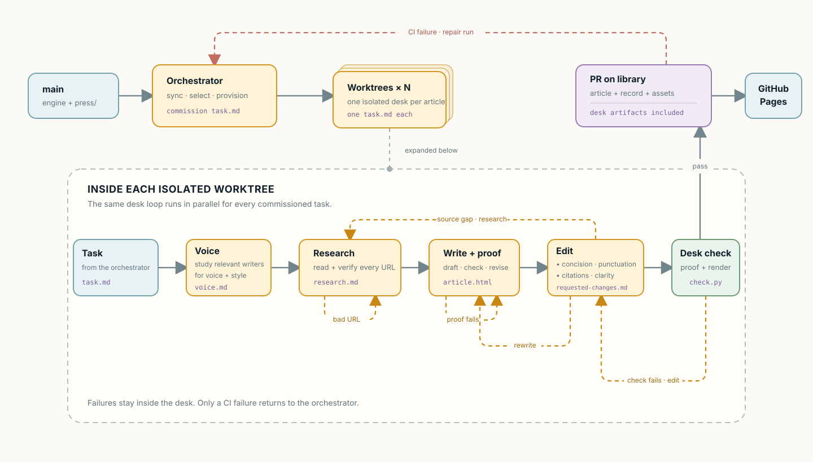

# The Nightly Build

## Your own AI-researched paper

The Nightly Build turns a GitHub repository into a personal newspaper. Fork it,
point an AI coding agent at your fork, and ask for an article on any topic,
question, or link. It researches, writes, verifies citations, and publishes to
GitHub Pages. Add a schedule for a fresh edition every morning.

**No backend and no new accounts. Your paper, config, and archive live in your
fork.**

> [!NOTE]
> Public papers appear at
> [the-nightly-build.github.io](https://the-nightly-build.github.io/). Opt out
> in `press/site.yaml` with `directory: { publish: false }`.

## Get started

Fork this repository with **Copy the main branch only** checked, then connect an
agent:

- **Terminal (`gh`):** sign in with `gh` as the fork owner, clone your fork, and
  open it in Claude Code or Codex.
- **ChatGPT Work (no terminal):** connect GitHub with branch/PR access to your
  fork, enable **Actions**, and set **Settings → Pages → Source** to
  **GitHub Actions**.

Ask the assistant:

> Help me set up my Nightly Build paper in `<owner>/<repo>` and write my first
> article about `<topic>`. Follow the repository's instructions.

If unconfigured, the assistant runs `./nb setup` and lists any GitHub settings
that need you. Clean Article PRs auto-merge after `validate` passes and publish
to Pages. Add "let me read it first" to open a draft PR instead.

## How it works

Agents handle research, writing, and editing. Repository-owned code and CI
enforce citations, rendering, and the publication gate. See
[Architecture](docs/concepts/architecture.md) and
[Schedule publication](docs/guides/operate/schedule.md).

## Documentation

| Start here                                                     | Operate & customize                                                 | Reference & architecture                                          |
| -------------------------------------------------------------- | ------------------------------------------------------------------- | ----------------------------------------------------------------- |
| [Ask your AI](docs/getting-started/ask-your-ai.md)             | [Schedule publication](docs/guides/operate/schedule.md)             | [Feature catalog](docs/reference/README.md)                       |
| [Set up your paper](docs/getting-started/setup.md)             | [Publish an article now](docs/guides/publish/publish-now.md)        | [Series reference](docs/reference/series.md)                      |
| [Your first article](docs/getting-started/first-article.md)    | [Revise an article](docs/guides/publish/revise-an-article.md)       | [Production & models](docs/reference/production.md)               |
| [Create your paper](docs/getting-started/create-your-paper.md) | [Appearance & voice](docs/guides/customize/appearance-and-voice.md) | [Architecture](docs/concepts/architecture.md)                     |
| [Agent integrations](docs/integrations/README.md)              | [Update the engine](docs/guides/operate/update-engine.md)           | [Publishing & security](docs/concepts/publishing-and-security.md) |

See the [full documentation index](docs/README.md) or
[troubleshooting](docs/troubleshooting/setup-and-scheduling.md).

## FAQ

<strong>Why build this?</strong>

Asking an AI for each topic manually was tedious, fact-checking erased the time
saved, and mainstream coverage starts from other people's frames. Running
overnight lets four roles spend an hour researching, writing, checking, and
revising while you sleep, inside a fork you own.

<strong>How do you avoid AI slop and hallucinations?</strong>

A writing coach anchors each piece on real human exemplars, every cited source
must be fetched and read, and an adversarial editor cuts unsupported claims.
Codified checks enforce banned terms and structural rules before publishing. No
system guarantees 100% accuracy, but unsupported work is hard to publish.

<strong>What can the scheduled runtime access, and why use pull requests?</strong>

Only what you grant it: web access, `main` and `library`, and permission to open
PRs against `library`. Each PR holds the article, assets, role records, and
validation output. CI checks untrusted diffs on `pull_request` with no secrets.
See [Publishing and security](docs/concepts/publishing-and-security.md).

<strong>Can it read paywalled or authenticated sources?</strong>

Not natively, though you can configure authenticated access in your own agent
runtime. See
[issue #127](https://github.com/the-nightly-build/the-nightly-build/issues/127).

<strong>What does it cost?</strong>

No service fee and free GitHub Pages hosting; you pay only for your AI runtime.
One requested article took ~45 minutes and ~500k–1M tokens across four roles
before repairs. A scheduled run of 5–7 parallel articles took 45–90 minutes. See
[Production cost and role models](docs/reference/production.md).

<strong>Can I keep my paper private or modify the engine?</strong>

Private papers work on GitHub plans that support private Pages. Put paper
changes under `press/` for conflict-free engine updates. Editing engine files
directly means owning future merge conflicts.

