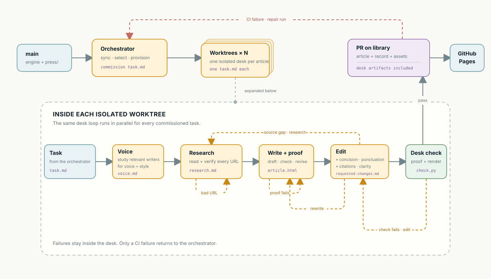

# Architecture

The Nightly Build splits responsibility in two:
**agents make editorial judgments**, and
**repository-owned code enforces the publication boundary**. The diagram starts
once authorized work is selected and ends when GitHub Pages deploys the site.

## Authorizing work

The press lives on `main`; published articles live on `library`.

- **Manual requests:** the assistant records the request as an authorized
  commission.
- **Scheduled runs:** `nb duty` compares `main` and `library` to return due work
  deterministically (handling cadence and reruns without model judgment). The
  orchestrator makes editorial choices inside that list but cannot add to it.

See [Schedule publication](../guides/operate/schedule.md) and
[Ownership and branches](ownership-and-branches.md).

## Orchestrator and editorial roles

The orchestrator plans the edition and creates an isolated workspace per
article. Isolation prevents sources, drafts, and instructions from leaking
between pieces and enables parallel runs. Runtimes without child agents run the
same role sequence and produce identical records sequentially.

For each commission, the engine assembles governing context from the current
repository revision. Roles read named files directly rather than relying on
orchestrator summaries. When a role has a question, it asks the orchestrator,
which answers from the commission, decides, or spawns a subagent while the role
continues. If the editor rejects the argument, the writer redrafts.

The **writing coach** is the only skippable role. When a series pins a
`voice_guide`, the engine supplies it directly and production starts at
research. The article still records the coach file, so the writer and editor
read the same contract either way.

Every role invocation saves its exact input and output. Repair rounds append to
this record rather than overwriting it, preserving the full history.

## Engine checks and the Article PR gate

The `nb` CLI handles deterministic work: assembling context, validating output,
building assets, previewing pages, and preparing PR commits. Local checks
shorten the repair loop but never grant publication authority.

After editor approval, `nb prepare-pr` packages one workspace into a single
commit and opens a PR against `library`. CI evaluates the untrusted diff using
the trusted engine from `main` with no scheduler secrets. Failures return to the
owning role; a valid new-article PR auto-merges and triggers a static GitHub
Pages build.

Manual articles follow the same orchestrator and PR gate, skipping only
`nb duty`. Revisions use the same validation boundary but always require human
review.

See [Publishing and security](publishing-and-security.md) for the trust model
and [Ownership and branches](ownership-and-branches.md) for branch layout.
